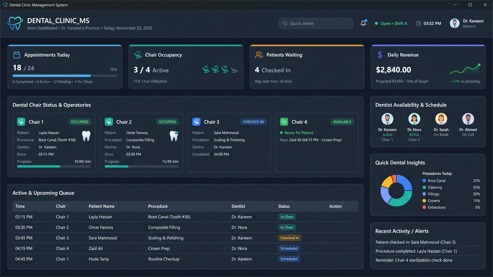

# DENTAL_CLINIC_MS — Dental Clinic Management System

A C# / .NET management system, dashboard service, and console/UI architecture for **Dental Clinic Management System** (`DENTAL_CLINIC_MS`), designed to aggregate daily clinic operations, clinical charting, smart scheduling, staged billing, sterilization compliance, and role-based governance[cite: 1, 2, 3, 4, 5].



## Overview

The system separates core clinic domain logic, operational metrics, and clinical workflows from presentation code so your team can run services as a console utility or wire them into a desktop or web UI (such as WPF, WinForms, .NET MAUI, ASP.NET Core MVC, or Blazor).

### Core Capabilities & Novel Contributions
- **Main Operations Dashboard:** Tracks daily appointments, completed visits, active in-chair patients, waiting/checked-in patients, cancellations/no-shows, daily revenue, dental chair occupancy (`Chair 1` through `Chair N`), chronological queue ordering, and a `TimeProvider`-backed clock for deterministic testing[cite: 1].
- **Interactive Odontogram & Treatment Charting (Clinical Novelty):** Provides an interactive tooth-by-tooth charting view where clicking a tooth updates clinical states (caries, crown, root canal, missing, implant), logs procedure dates, and links clinical notes to multi-visit treatment plans[cite: 2].
- **Smart Appointment Scheduler & No-Show Risk Analytics (Scheduling Novelty):** Combines a multi-chair weekly schedule grid with automated chair/dentist conflict alerts, no-show probability indicators (based on past cancellation history, lead time, and visit type), and an open-slot optimizer[cite: 3].
- **Treatment Plan Costing, Installments & Sterilization Audit (Workflow & Compliance Novelty):** Supports itemized procedure invoicing, staged treatment plan cost estimates with installment tracking, and autoclave/instrument sterilization cycle compliance logs[cite: 4].
- **Clinic Analytics, Role-Based Access & Audit Trail (Engineering Rigor):** Delivers revenue vs. chair utilization insights, Role-Based Access Control (Admin, Dentist, Receptionist), and an activity audit log tracking sensitive access and changes[cite: 5].

## Screen & Module Previews

### 1. Main Operations Dashboard

Displays daily appointment counts, chair occupancy, waiting patients, daily revenue, live dental chair status, active/upcoming queues, dentist availability, procedure breakdowns, and recent activity alerts[cite: 1].

### 2. Interactive Odontogram & Treatment Charting

Tracks patient clinical details and allergies alongside an interactive tooth map (caries, crown, root canal, missing, implant), quick charting actions, clinical treatment notes, a treatment planning checklist, and a historical/planned treatment timeline[cite: 2].

### 3. Smart Appointment Scheduler & No-Show Risk Analytics

Features a multi-chair weekly schedule grid, automated chair conflict detection and resolution alerts, no-show risk scoring with outreach actions, and available slot optimization suggestions[cite: 3].

### 4. Digital Invoice, Treatment Plan Costing & Sterilization Audit

Combines itemized billing and installment tracking for multi-stage treatment plans with autoclave sterilization cycle logs (temperature, pressure, duration, indicator/audit status) and compliance checks[cite: 4].

### 5. Clinic Analytics, Role-Based Access & Audit Trail

Visualizes revenue against chair utilization rates, enforces role permissions across Admins, Dentists, and Receptionists, and records a timestamped system activity audit log[cite: 5].

## Project Structure

```text
Dental_Clinic_MS/
├── assets/
│   ├── dashboard-preview.png   # Main operations dashboard UI preview
│   ├── f1.png                  # Interactive odontogram & treatment charting preview
│   ├── f2.png                  # Smart scheduler & no-show risk analytics preview
│   ├── f3.png                  # Billing, treatment costing & sterilization audit preview
│   └── f4.png                  # Analytics, RBAC & audit trail preview
├── DentalDashboardService.cs   # Core models, IDentalClinicRepository, and DentalDashboardService
├── Program.cs                  # Sample repository and console dashboard runner
├── README.md                   # Project documentation
└── Dental_Clinic_MS.csproj      # .NET project file
